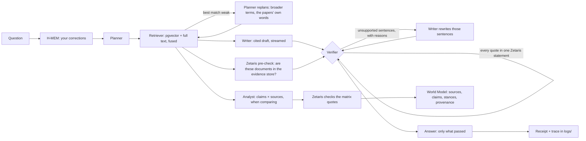

# Konkyo

**A research library whose agents answer only from your sources, and prove every quote.**

Konkyo (根拠, "grounds" or "evidence") reads your papers, lecture recordings, slides and notes.
Ask it a question and a team of agents finds the passages, writes a cited answer, checks every
quote word for word in Zetaris, sends unsupported sentences back to be rewritten, and shows you
where your sources agree and where they don't. Every answer comes with its receipt: the passages,
the checks, and the SQL that ran them.

**Live:** [konkyo.xyz](https://konkyo.xyz) (ask three real papers on the landing page; no
account needed to walk in) · **Docs:** [docs.konkyo.xyz](https://docs.konkyo.xyz) ·
**Made with:** [the partners, in the code](https://konkyo.xyz/made-with/zetaris)

Open Agent Hackathon 2026, **Track 02: The Agent That Can Explain Why**:
*"Build agents that investigate complex questions across multiple data sources, connect findings,
and produce evidence-backed answers or recommendations."*

## Try it in one minute (no keys, no services)

```bash
git clone <this repo> konkyo && cd konkyo
corepack enable && pnpm install
pnpm konkyo ask --sample
```

Sample mode replays a run recorded against real services: the replies Nemotron (on NVIDIA's API),
Zetaris and the library search gave are handed back, and every step of Konkyo's own logic runs again on them
(planning, citation parsing, the quote checks, the Verifier's verdicts and rewrites, the
agree/disagree matrix, the World Model, the trace). It prints the cited answer and the path of the
new trace in `logs/`. `pnpm konkyo samples` lists the five recorded questions; see
[examples/](examples/README.md) for their outputs and traces.

```
$ pnpm konkyo ask --sample 2
Sample mode: replaying the replies Nemotron, Zetaris and the library search gave on 2026-10-21.
No keys and no services: every agent step below runs again on those replies.

What role do sleep spindles play in memory, and do these papers agree about it?
  ✓ Planning · What role do sleep spindles play in memory, and do these papers agree about it?
  ✓ Searching your library · 16 passages from 3 files
  ✓ Checking sources in Zetaris · 3 of 3 files confirmed
  ✓ Comparing sources · 3 claims across 3 sources
  ✓ Writing
  ✓ Verified 2 citations

Sleep spindles are associated with memory consolidation during sleep, but it is unclear whether
the relationship is causal [1].
…
Sources (2)
Each quote was found word for word in Zetaris's own reading of the source.

[1] Diekelmann · 2014, Sleep for cognitive enhancement, p. 5
    “Although spindles have frequently been associated with memory consolidation during sleep, it
    is unclear whether sleep spindles can be externally manipulated.”
…
```

## Who it's for

Students and researchers who read a lot and have to cite what they read: a thesis student with
forty PDFs, a course's lecture recordings and slides, a reading group comparing papers. The
problem is trust. General chat assistants answer fluently from memory, mix up sources and invent
quotes; checking them takes as long as reading. Konkyo answers only from your library, says "Not
in your library" when it can't, and makes every claim checkable in one click: the citation opens
the source at the passage, highlighted.

## How an answer is made



| Agent | Does | Model (NVIDIA Nemotron) |
|---|---|---|
| Planner | Rewrites the question to stand alone, plans 1–3 searches, flags comparisons, reads the person's corrections from H-MEM first; when the first search comes back thin, replans from what it found and searches again before saying "Not in your library" | Nemotron 3 Ultra |
| Retriever | Hybrid search: pgvector cosine and Postgres full text per query, fused by Reciprocal Rank Fusion; questions embedded as queries, passages as passages | Nemotron 3.5 Embed |
| Writer | One finding per sentence, each with a citation and an exact quote from its passage | Nemotron 3 Ultra |
| Verifier | Checks each quote in code, then all of them in **one Zetaris statement** against Zetaris's own reading of the PDF; judges whether each sentence's quotes support it; sends failures back with reasons (at most two rewrite rounds); anything that still fails is dropped, never shown as verified | Nemotron 3 Ultra |
| Analyst | When a question weighs several sources: 3–6 specific claims × sources with agrees / disagrees / partly, each stance quoted and checked in Zetaris, recorded in the World Model. Also places each paper a watch finds: agrees with, disagrees with, or new to your sources, your passage quoted | Nemotron 3 Ultra |
| Scout | Deep search: OpenAlex papers and Wikipedia articles, screened in Markovian steps, imported and read before answering | Nemotron 3.5 Lightning plans, Ultra screens |
| Tutor | Practice items from your passages, every answer key checked by the Verifier and every quote in Zetaris | Nemotron 3 Ultra |

Public questions, profiles and articles go through Nemotron 3.5 Content Safety first. Each role has
a fallback model for errors, stalls (no answer within 45 s) and malformed replies; the switch is
logged. The models and their thinking switch were picked by a measured benchmark on NVIDIA's API:
Ultra with thinking off was the only setup to pass every test (0/10 false rejections, 6/6 planted
errors caught, 9/9 quotes verbatim).

## Sponsor technology

Each partner has a page on konkyo.xyz that follows one action into the code, with a live
example: [Zetaris](https://konkyo.xyz/made-with/zetaris) (three quotes checked in one statement
as you watch), [Meterless](https://konkyo.xyz/made-with/meterless),
[NVIDIA Nemotron](https://konkyo.xyz/made-with/nvidia), [ElevenLabs](https://konkyo.xyz/made-with/elevenlabs)
(a real two-voice brief), [Composio](https://konkyo.xyz/made-with/composio) and
[OpenAlex](https://konkyo.xyz/made-with/openalex) (a live search). Their "follow it in the code"
excerpts are copied from this repository by `pnpm made-with:code`.

### Zetaris: the evidence store every claim is checked against

Konkyo's answers are only as good as the check, and the check is Zetaris. Remove it and nothing
can be marked verified.

- **Evidence store.** When a file is read, the worker publishes its passages as JSON to a Zetaris
  `FILESTORE` table (`konkyo.konkyo_passages`), hands Zetaris the PDF rendition, and keeps
  **Zetaris's own PDFBox reading** of it (`konkyo.konkyo_pdf_text`), a second extraction
  independent of Konkyo's. A file is marked Ready only after Zetaris answers for it.
  [`packages/zetaris/src/evidence.ts`](packages/zetaris/src/evidence.ts)
- **Pre-check.** Before the Writer's draft is checked, one statement confirms the retrieved
  documents are in the evidence store. [`checks.ts`](packages/zetaris/src/checks.ts)
- **Quote verification.** Every quote of an answer is checked in **one** Spark SQL statement: a
  `VALUES` list joined to Zetaris's PDF text (recordings: to the stored transcript passages), a
  quote counting only if its normalised words appear verbatim. The same check runs for the
  Analyst's matrix, study items, lecture notes and audio briefs. The statement is shown in the
  app's receipt ("Show SQL") and in [examples/](examples/02-agree-disagree/output.md).
- **Agents that watch a topic.** A watch is a Zetaris Lightning `REST` table over OpenAlex; each
  run refreshes it and finds new papers with one `LEFT ANTI JOIN` against the DOIs already seen.
  [`watch.ts`](packages/zetaris/src/watch.ts)
- Every Zetaris call is in the trace as `queried_zetaris` with the statement's hash and rows.

### Meterless: memory, world state and long-task reasoning

The three engines are vendored unchanged (Apache-2.0) in [`packages/meterless`](packages/meterless/NOTICE)
and driven from [`packages/agents`](packages/agents/src).

- **H-MEM** ([`memory.ts`](packages/agents/src/memory.ts)): a 👎 with a reason, "wrong passage",
  or "this item is wrong" becomes a correction in the person's memory, with provenance. The
  Planner reads relevant corrections before every answer (H-MEM's hybrid ranking, then an
  embedding gate); 👍/👎 on an answer adjusts the confidence of the memories it used. The knows
  page shows them; cross one out and it's forgotten.
- **World Model** ([`analyst.ts`](packages/agents/src/analyst.ts)): the Analyst records each
  comparison as sources, claims and `supports` / `contradicts` / `qualifies` relations, each with
  the passage it was read from, in one event-sourced model per person.
- **Markovian** ([`scout.ts`](packages/agents/src/scout.ts)): deep search screens what it found
  in bounded RESEARCH steps that carry only the shortlist forward; Markovian's own estimate of the
  tokens saved is shown on the approval card and logged.

## Everything else it does

- **Spaces:** each subject or project is a space with its own colour and wall: its sources,
  pinned answers, notes, practice and audio brief in one place, made from a template (exam prep,
  essay, literature review, reading group). Share one with an invite link or by email; members
  are there live (who's here, sources landing as they're added, a space chat that can ask
  @konkyo), pin answers to the wall and leave takes on sources. Each space has its own email
  address: forward it a paper and it lands on the wall (mail from outside the space waits for the
  owner's yes).
- **Library:** PDF, Word, PowerPoint, Markdown, text, web pages, YouTube, audio and video
  (transcribed with ElevenLabs Scribe, cited to the second). ⌘K, Trash, DOI import. Every
  document gets a PDF rendition, so one viewer highlights any citation.
- **Ask:** from the dock, over the whole library, a space or chosen files; the agree/disagree
  matrix; the receipt with steps, sources, memories and SQL; "Not in your library" with Find
  sources. **Catch me up** says what moved since your last visit.
- **Voice:** talk to the orb (ElevenLabs Scribe Realtime); it answers on a card built while you
  speak and says the short answer out loud.
- **Deep search:** finds papers (OpenAlex, open access) and web pages, imports them, answers.
- **Write:** notes with citation chips, "Find a source" for a sentence, "Check my draft"
  (supported / partly / contradicted / not found), versions with a diff, export to Word in any
  CSL style or to Google Docs, and **publish** as a public article whose every claim was checked
  before it went out.
- **Study:** quizzes and games from your sources with checked answer keys, hints that never give
  the answer away, spaced repetition (FSRS) and streaks. **Live rounds:** play a quiz together in
  a shared space with a join code; answers turn face up together with the passage.
- **What it knows:** your corrections (H-MEM) and where your sources stand on each claim (World
  Model), yours and each space's, readable and editable.
- **Agents:** saved standing tasks: watch a topic for new papers, or quiz a folder on a schedule.
- **Public spaces:** a read-only link anyone can read and ask, with moderation and caps.
- **Audio brief:** two voices talk through a space (ElevenLabs), every line cited and checked.
- **Connectors:** Gmail, Google Drive and Notion through Composio; imports resync when they
  change.
- **People:** profiles with handles, follows, and a guest entry that needs no account: keep it
  later with Google or a code by email.
- **Email** (Resend): sign-in codes, mail to a space, invites, and an opt-in weekly digest.

## Entry points

| | |
|---|---|
| Web app | `pnpm dev` → http://localhost:3210 (sign in with Google or as a guest) |
| CLI | `pnpm konkyo ask "<question>" [--folder <name>] [--compare] [--json]` (see `pnpm konkyo help`) |
| Sample mode | `pnpm konkyo ask --sample [n]`, no keys or services |
| HTTP | `POST /api/v1/ask` with a key from Settings → API keys |

```bash
curl -X POST http://localhost:3210/api/v1/ask \
  -H "Authorization: Bearer $KONKYO_API_KEY" -H "content-type: application/json" \
  -d '{"question": "How does sleep help memory?"}'
```

It returns the answer, citations, matrix, receipt and the full trace as JSON; with
`Accept: application/x-ndjson`, every agent step streams as a line. The question lands in Chats
like any other.

## Run it yourself

Needs Node 22.18+, pnpm (via `corepack enable`), Docker, a Zetaris instance and an NVIDIA API key
(free at [build.nvidia.com](https://build.nvidia.com/settings/api-keys)).

```bash
cp .env.example .env            # fill it in; every variable is described there
pnpm install
pnpm services:up                # Postgres + pgvector, RustFS (S3), Gotenberg
pnpm services:check
pnpm db:migrate
pnpm dev                        # web app on :3210, the worker, docs on :3211
```

**Zetaris:** the hackathon's instance (set `ZETARIS_REST_URL` and `ZETARIS_API_KEY`), or the local
bundle (`ZETARIS_LOGIN_URL`, `ZETARIS_USERNAME`, `ZETARIS_PASSWORD`, `ZETARIS_ORG_ID`).
`EVIDENCE_DIR` is where the worker writes evidence files and `ZETARIS_EVIDENCE_URI` is the same
folder as Zetaris sees it. **ElevenLabs** is needed for recordings and audio briefs; **Google
OAuth** for sign-in; **Composio** and **VAPID** keys are optional.

**All in Docker** (what production runs): `infra/compose.prod.yaml` builds the web app, the
worker (with OCRmyPDF and yt-dlp) and the docs from their Dockerfiles, and runs them with
Postgres, RustFS and Gotenberg. Migrations run first; web and worker share one `/data` volume
(traces, memory, World Model). Zetaris stays outside (set `ZETARIS_*`).

```bash
docker compose -f infra/compose.prod.yaml up -d --build
```

A sample library for the CLI: `pnpm konkyo seed --user you@example.com`, then
`pnpm konkyo ask "Does a nap help motor learning?" --user you@example.com --folder "Essay starter: Sleep and learning"`.

## Repository

```
apps/web          Next.js 16 app: UI, API routes, the chat's answer stream, /api/v1/ask
apps/worker       pg-boss worker: ingest pipeline, deep search, study sets, agents, briefs, sync
apps/cli          pnpm konkyo: ask, samples, seed
apps/docs         the docs site (Fumadocs, static export)
packages/agents   Planner, Retriever, Writer, Verifier, Analyst, Scout, Tutor; models; tracer
packages/zetaris  Zetaris REST client, evidence store, quote checks, watch tables
packages/meterless  H-MEM, World Model, Markovian (vendored, Apache-2.0)
packages/tape     record and replay for sample mode
packages/ingest   conversion (Gotenberg), PDF text and boxes, OCR, transcription, web capture
packages/db       Drizzle schema and migrations (Postgres + pgvector)
packages/…        config, env, jobs, storage, notify, connectors, study (FSRS), ui
examples/         five recorded runs: input, output, trace, tape
logs/             one JSONL trace per run
```

## Traces

Every run writes `logs/<runId>.jsonl`: which agent did what, with which model, against which
Zetaris statement (by hash), rows returned, verdicts (`approved`, `rejected_to_writer`,
`escalated_to_fallback`), latency and tokens. The app shows the same run as the receipt.

## Limits

- **Models run on NVIDIA's free API tier**: about 40 requests a minute for each model, split
  between the web app and the worker. A busy minute queues calls rather than failing them, so
  answers slow down under load; sample mode needs no key.
- **Live use needs Zetaris.** Nothing is marked verified without it, by design.
- **Sample mode replays recorded questions only.** Any other question is refused, not invented.
- **Fair-use caps** (no paywall): 300 answers, 20 deep searches and 300 files a day per account;
  guests get less (60, 3, 40). Settings → Usage shows them.
- **Connectors** use Composio-managed Google auth, whose consent screen asks for wider Gmail
  scopes than Konkyo uses (it only reads). A read-only auth config needs your own Google OAuth
  client.
- Scanned PDFs are read with OCRmyPDF (installed, or its Docker image); handwriting and complex
  tables can come out imperfect.


## Licences and credits

- **OurSpaces** ([thomasnguyen/ourspaces-app](https://github.com/thomasnguyen/ourspaces-app), MIT,
  © 2026 Thomas Nguyen): Konkyo's look is ported from it: the design system's tokens and walls,
  the landing and made-with pages (its About and vendor pages), the voice stage's choreography,
  and the voice orb's WebGL shader ([`orb-shader.ts`](apps/web/lib/orb-shader.ts)).
- **Interface sounds** (tap, place, check, promote) are from [Mixkit](https://mixkit.co/free-sound-effects/)
  under the [Mixkit Sound Effects Free License](https://mixkit.co/license/#sfxFree), trimmed as
  OurSpaces' sound notes describe. The five study sounds were made once with ElevenLabs' sound
  effects model ([`make-sounds.ts`](packages/ingest/scripts/make-sounds.ts)).
- **Fonts:** Bricolage Grotesque and IBM Plex (SIL Open Font License).
- **Code highlighting** on the made-with pages: [Shiki](https://shiki.style) (MIT), run at build.
- The Meterless engines are Apache-2.0 ([NOTICE](packages/meterless/NOTICE)). The sample sources
  are openly licensed (CC BY and CC BY-NC-SA); see [examples/](examples/README.md#sources-and-licences).
