<p align="center">
  <a href="https://konkyo.xyz">
    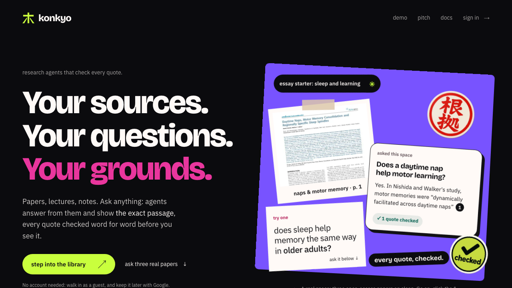
  </a>
</p>

<h1 align="center">Konkyo · 根拠</h1>
<p align="center"><b>Every answer shows its grounds.</b><br/>Everything you study, in one library. Agents check every answer.</p>

<p align="center">
  <a href="https://konkyo.xyz"><b>Open Konkyo</b></a>
  &nbsp;·&nbsp;
  <a href="https://konkyo.xyz/demo"><b>Demo</b></a>
  &nbsp;·&nbsp;
  <a href="https://docs.konkyo.xyz"><b>Docs</b></a>
  &nbsp;·&nbsp;
  <a href="https://konkyo.xyz/made-with/zetaris"><b>Watch a quote get checked</b></a>
  &nbsp;·&nbsp;
  <a href="examples/README.md"><b>Recorded runs</b></a>
</p>

**Konkyo is one library for everything you study.** Bring in papers, lectures, notes, slides,
recordings and web pages, sorted into spaces you can share, then ask, practise, write and listen
from them. Behind every answer, a team of research agents works across your sources: they answer
only from them, check every quote word for word in **Zetaris**, remember your corrections and who
said what with **Meterless** engines, and show where your sources disagree. **NVIDIA Nemotron**
plans each answer, finds its passages and guards what's shared.

Built for **Open Agent Hackathon 2026 · Track 02: The Agent That Can Explain Why**
([how it meets the track](#how-konkyo-meets-the-hackathon)). *Konkyo* (根拠) is Japanese for
"grounds" or "evidence".

## In plain words

Konkyo answers your questions from *your own* files, and then proves each answer. Three partners
make that work:

- **Zetaris is the fact-checker.** Every file you add is also read by Zetaris, in its own way.
  When the AI writes an answer, we ask Zetaris one question in SQL: are these exact words in the
  original? A quote only gets a tick if Zetaris finds it. If it doesn't, the sentence is fixed or
  dropped. ([`packages/zetaris`](packages/zetaris/src))
- **Meterless is the memory.** Three of its engines each do one job. *H-MEM* remembers what you
  correct and reads it before every new answer. *World Model* keeps a map of which source says
  what, which is how the agree and disagree table works. *Markovian* reads a long list of found
  papers in small steps, so a deep search stays focused. ([`packages/agents`](packages/agents/src))
- **NVIDIA is the planner and the back-up.** Nemotron plans each answer, finds the right passages
  by meaning, understands spoken questions, checks public pages for safety, and takes over every
  OpenAI job when OpenAI is busy. ([`packages/models`](packages/models/src))

The tables further down give the technical detail, and each partner has a page on the live site
that follows one real action into the code.

## The problem

A student revising for an exam, or anyone writing an essay, reads across many sources at once:
papers, lecture recordings, slides, their own notes. Many now ask an AI to pull them together.
Then the real work starts:

1. Upload the files and ask.
2. Get a fluent answer with numbered references.
3. Open each source and hunt for the line behind each sentence, because a reference can point to
   a page that says something else.
4. Read the sources side by side to see where they disagree, because one smooth answer rarely
   says so.

Skip steps 3 and 4 and a claim no source makes can end up in the essay. In July 2025, NTU Singapore
[upheld a zero mark](https://www.ntu.edu.sg/sss/news-events/news/detail/ntu-upholds-grade) on an
essay for 14 false citations or data.

Tools that answer from your uploads now link each sentence to a passage. The link shows where the
answer looked, not whether the passage says the same thing, so the checking is still yours.
Research search engines show where published papers agree, but only across their own index, not
your lectures and notes.

## The idea

Konkyo gives the checking to agents. They answer only from your library, and a citation gets its
tick only after the Verifier finds its quote word for word in Zetaris. A sentence it can't back
goes back to the Writer, at most twice, and is dropped if it still fails. With **Compare** on, the
Analyst lines the sources up claim by claim. Your job shrinks from checking every line to clicking
a tick to read the passage.

### One question, start to finish

Here the agents do the work Track 02 asks for. Three open-access papers on sleep, one question
with **Compare** on, asked on testing: *What role do sleep spindles play in memory, and do these
papers agree about it?*

<p align="center">
  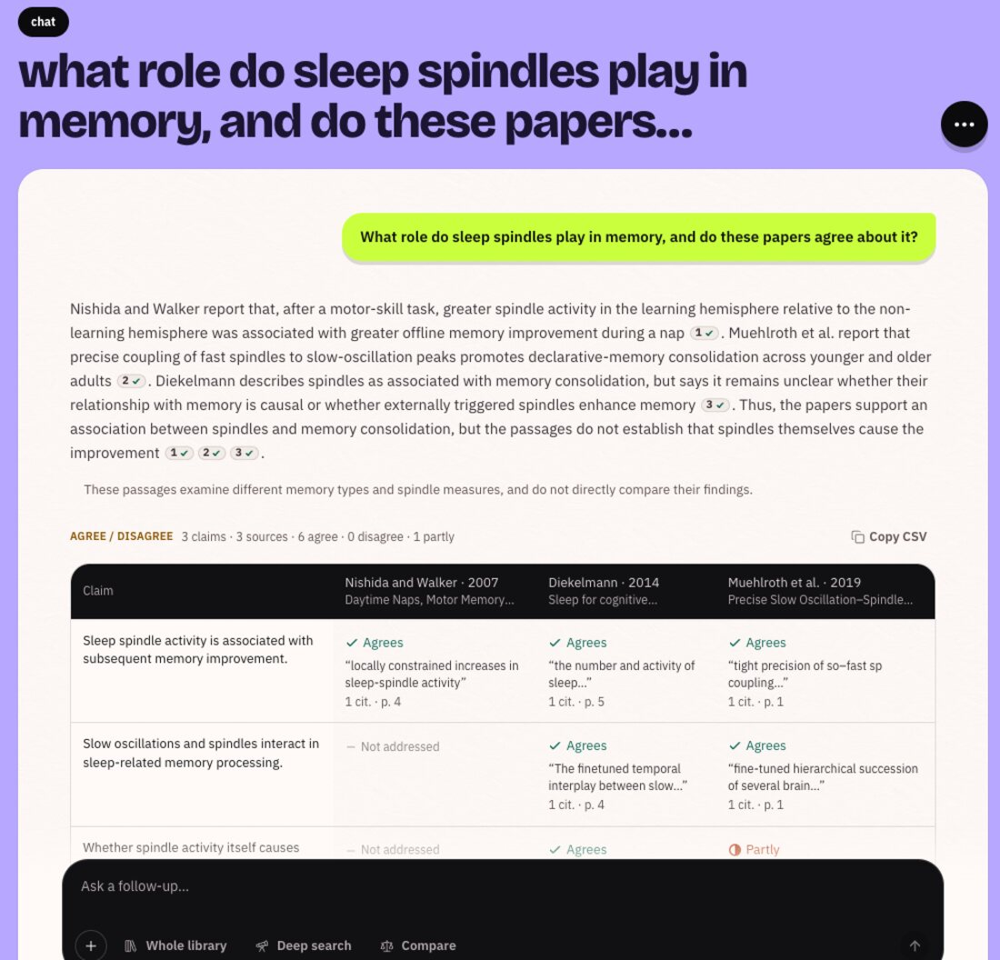
</p>

**Each finding names its paper, and every citation is ticked** because its quote was found in
the source. The Analyst lays the papers side by side: where they agree, disagree or partly do.

<p align="center">
  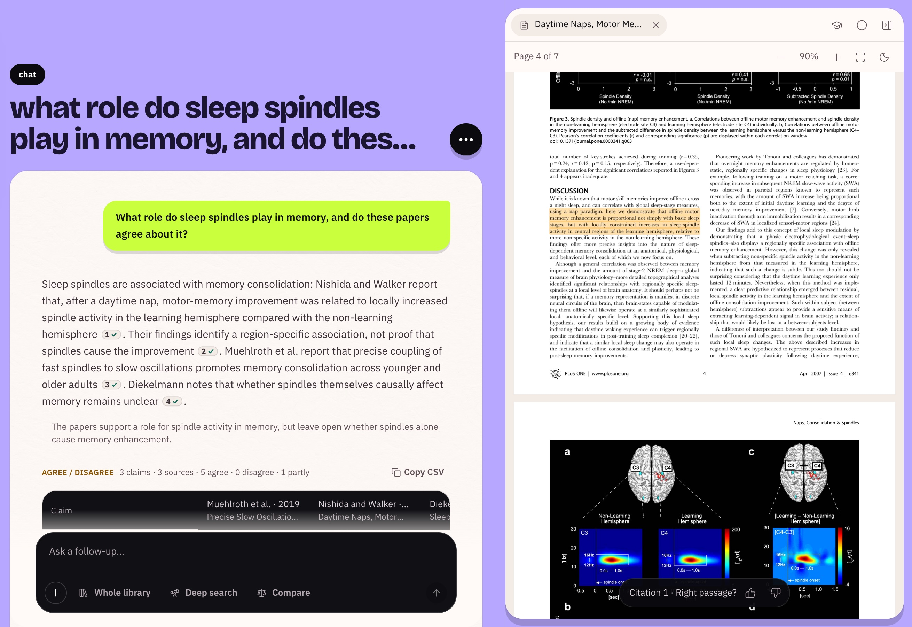
</p>

**Click a citation and the paper opens at the page**, the passage highlighted.

<p align="center">
  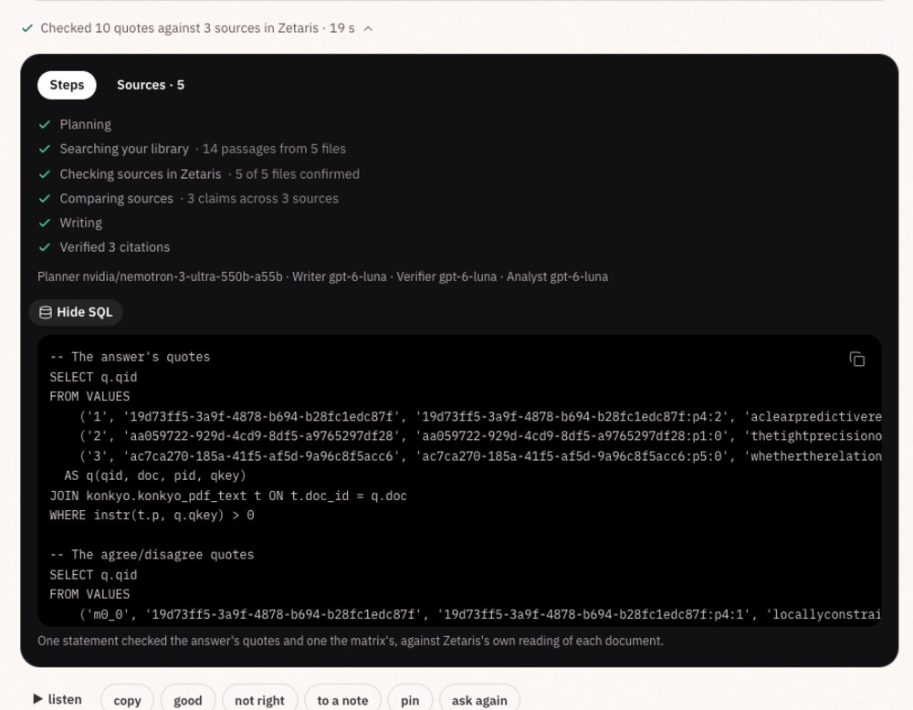
</p>

**Every answer has a receipt:** the steps, the models behind the Planner, Writer, Verifier and
Analyst, and the SQL Zetaris ran to find every quote in its own reading of the PDFs (two
statements with Compare: the answer's quotes and the table's). When your library has no answer,
Konkyo says **This isn't in your library yet.** and offers a deep search.

## Demo video

<p align="center">
  <a href="https://konkyo.xyz/demo">
    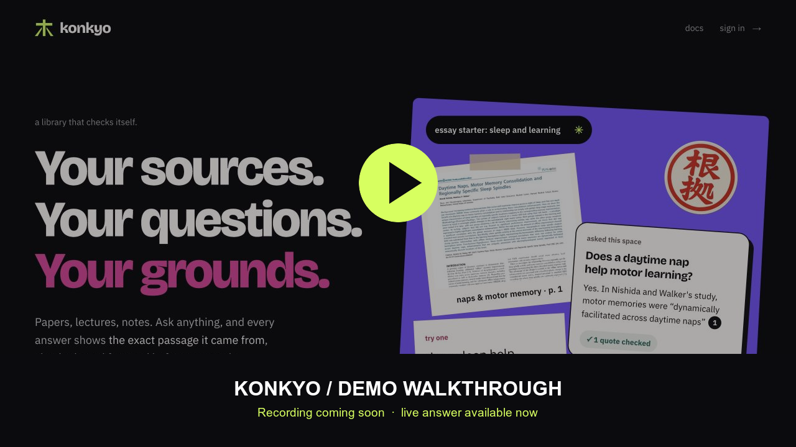
  </a>
</p>

The walkthrough video is being recorded. Until it's up, follow the proof on the live site, no
account needed:

1. On [konkyo.xyz](https://konkyo.xyz/#ask), ask the three-paper space a question.
2. Click a numbered citation: the paper opens at the passage.
3. See [one Zetaris statement check three quotes](https://konkyo.xyz/made-with/zetaris) as you watch.

## How it works

<p align="center">
  <a href="https://docs.konkyo.xyz/docs/build">
    <picture>
      <source media="(prefers-color-scheme: dark)" srcset=".github/assets/system-dark.png" />
      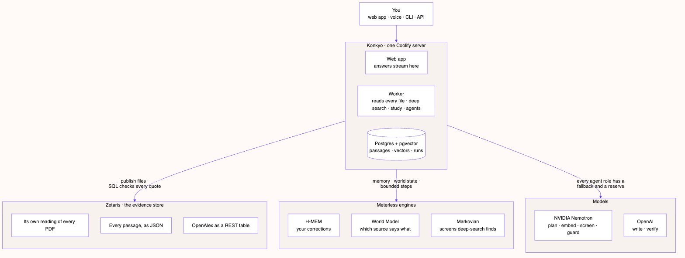
    </picture>
  </a>
</p>

[Open the detailed map](https://docs.konkyo.xyz/docs/build) · [Edit the Mermaid source](.github/diagrams/readme-system.mmd)

<p align="center">
  <a href="https://docs.konkyo.xyz/docs/agents/how-answers-are-checked">
    <picture>
      <source media="(prefers-color-scheme: dark)" srcset=".github/assets/journey-dark.png" />
      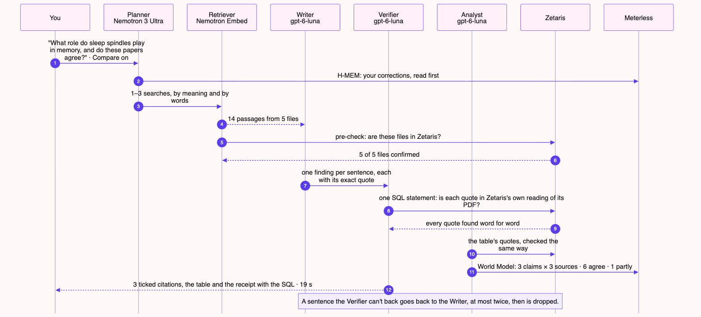
    </picture>
  </a>
</p>

[How an answer is checked](https://docs.konkyo.xyz/docs/agents/how-answers-are-checked) · [Edit the Mermaid source](.github/diagrams/readme-journey.mmd)

| Agent | Its job | Model |
|---|---|---|
| Planner | Reads your corrections, plans 1–3 searches, replans when results are thin | Nemotron 3 Ultra |
| Retriever | Searches by meaning and by words at once, and fuses the two | Nemotron 3.5 Embed |
| Writer | One finding per sentence, each with an exact quote | OpenAI `gpt-6-luna` |
| Verifier | Finds every quote in Zetaris, judges support, sends failures back | OpenAI `gpt-6-luna` |
| Analyst | Claims × sources: agrees, disagrees, partly, each quote checked | OpenAI `gpt-6-luna` |
| Scout | Deep search: finds open papers, screens them in Markovian steps, reads them | Nemotron 3.5 Lightning + 3 Ultra |
| Tutor | Practice from your passages, every answer key checked | OpenAI `gpt-6-luna` |

Every model role except the Retriever's embeddings has a fallback on the other provider and a
reserve on a third model, and each switch in a traced run is logged. The Screener, Grader and voice intent make nine roles:
[every role and its models](https://docs.konkyo.xyz/docs/agents).

### Built on

| Partner | What it does in Konkyo | In the code |
|---|---|---|
| **Zetaris** | The evidence store: every passage, and Zetaris's own reading of every PDF. One SQL statement checks every quote of an answer. Topic watches are REST tables over OpenAlex. | [`packages/zetaris`](packages/zetaris/src) |
| **Meterless · H-MEM** | Your corrections, read by the Planner before every answer | [`memory.ts`](packages/agents/src/memory.ts) |
| **Meterless · World Model** | Which source says what, with the passage it was read from | [`analyst.ts`](packages/agents/src/analyst.ts) |
| **Meterless · Markovian** | Screens deep-search finds in bounded steps that carry only the shortlist | [`scout.ts`](packages/agents/src/scout.ts) |
| **NVIDIA Nemotron** | 3 Ultra plans and screens; 3.5 Embed finds passages; 3.5 Lightning reads spoken asks; 3.5 Content Safety guards public pages; the fallback for every OpenAI agent role | [`packages/models`](packages/models/src) |
| **ElevenLabs** | Lecture transcripts cited to the second, read-aloud, two-voice audio briefs, the voice orb | [`packages/ingest`](packages/ingest/src) · [`voice-server.ts`](apps/web/lib/voice-server.ts) |
| **OpenAlex · Composio** | Open papers for deep search and watches · Gmail, Drive and Notion imports | [`scout.ts`](packages/agents/src/scout.ts) · [`connectors`](packages/connectors/src) |

Each partner has a page on konkyo.xyz that follows one action into the code:
[Zetaris](https://konkyo.xyz/made-with/zetaris) · [Meterless](https://konkyo.xyz/made-with/meterless) ·
[NVIDIA](https://konkyo.xyz/made-with/nvidia) · [ElevenLabs](https://konkyo.xyz/made-with/elevenlabs) ·
[Composio](https://konkyo.xyz/made-with/composio) · [OpenAlex](https://konkyo.xyz/made-with/openalex).

## How Konkyo meets the hackathon

Track 02: *"Build agents that investigate complex questions across multiple data sources, connect
findings, and produce evidence-backed answers or recommendations."*

| Requirement or criterion | How Konkyo meets it | Check it |
|---|---|---|
| "investigate complex questions across multiple data sources" | The Planner turns a question into searches across your papers, lectures and notes; deep search adds open papers and the web | [answer.ts](packages/agents/src/answer.ts) · [scout.ts](packages/agents/src/scout.ts) |
| "connect findings" | The Analyst's claims × sources table, kept in the World Model | [Example 02](examples/02-agree-disagree/output.md) |
| "evidence-backed answers" | A citation is ticked only once its quote is found word for word in Zetaris; it opens the passage | [The journey above](#one-question-start-to-finish) |
| Zetaris as the data layer | Every file is published to Zetaris; every answer's quotes are checked there | [made-with/zetaris](https://konkyo.xyz/made-with/zetaris) (live) |
| "at least one Meterless Engine in a working feature" | H-MEM (corrections), World Model (stances), Markovian (deep search) | [made-with/meterless](https://konkyo.xyz/made-with/meterless) |
| NVIDIA "wherever it contributes" | Nemotron plans, embeds, screens, guards, and stands in for every OpenAI agent role | [made-with/nvidia](https://konkyo.xyz/made-with/nvidia) |
| "Evidence of how the system reached its output" | A receipt under every answer; a trace per run in `logs/` | [Proof](#proof) |
| Logs show "which model handled each request" | Each trace step and the receipt name the model | [examples/](examples/README.md) |
| A `SAMPLE_MODE=true` fallback | Replays recorded runs with no keys or services | [Try it](#try-it-with-no-keys) |
| Impact (30) | Students and researchers stop checking AI answers line by line: every quote is checked against their own sources, and where the sources disagree is shown | [The problem](#the-problem) · [What Konkyo is](https://docs.konkyo.xyz) |
| Technical (20) | Nine model roles (Planner, Writer, Verifier, Analyst, Scout, Screener, Tutor, Grader, voice intent), a verify-and-rewrite loop, fallbacks, runs from a clean clone | [Agents and traces](https://docs.konkyo.xyz/docs/agents) |
| Innovation (15) | Quotes checked against an independent reading of the source, in SQL | [How answers are checked](https://docs.konkyo.xyz/docs/agents/how-answers-are-checked) |
| Product & UX (10) | One library to ask, practise, write, listen and share, every part built on the same check; guests start without an account | [The whole library](#the-whole-library) |

## Try it with no keys

```bash
corepack enable && pnpm install
SAMPLE_MODE=true pnpm konkyo ask --sample 2
```

No `.env`, keys, database or Docker. Sample mode replays the replies OpenAI, Nemotron, Zetaris
and the library search gave in a recorded run, and every step of Konkyo's own logic runs again on
them: planning, the quote checks, the Verifier's rewrites, the matrix, the World Model and a new
trace. `pnpm konkyo samples` lists the five recorded questions.

## Proof

- **[Five recorded runs](examples/README.md):** input, answer, trace and tape for a cited answer,
  an agree/disagree table, a false premise corrected, a lecture with its textbook, and "Not in
  your library".
- **Traces:** every run writes `logs/<runId>.jsonl`: each agent's step and action (`approved`,
  `rejected_to_writer`, `escalated_to_fallback`…), its model, the Zetaris statement by hash, rows,
  verdicts, latency and tokens.
- **[The sample data](data/README.md):** eight openly licensed sources, their licences, and how
  they reach Zetaris.

## The whole library

The same agents and the same check sit under every part of Konkyo.

<table>
  <tr>
    <td width="50%">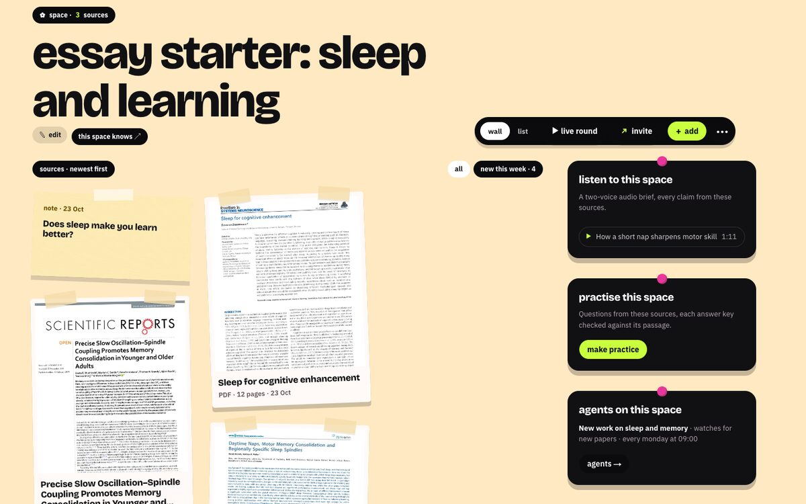</td>
    <td width="50%">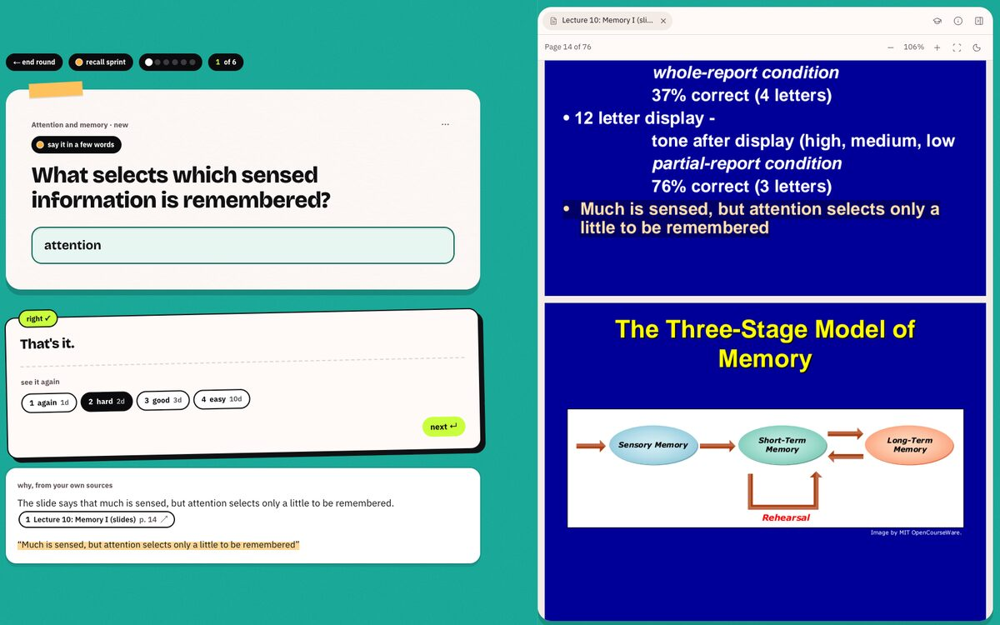</td>
  </tr>
  <tr>
    <td><b>Spaces.</b> A wall per subject. Share it live; its chat can ask @konkyo.</td>
    <td><b>Practise.</b> Quizzes and games whose answer keys were checked against their passages.</td>
  </tr>
  <tr>
    <td width="50%">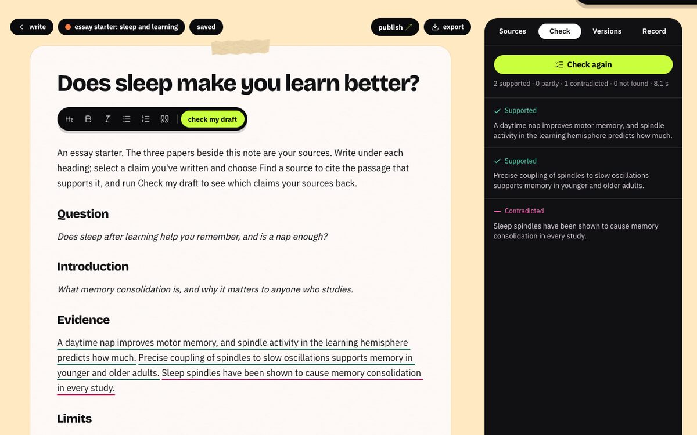</td>
    <td width="50%">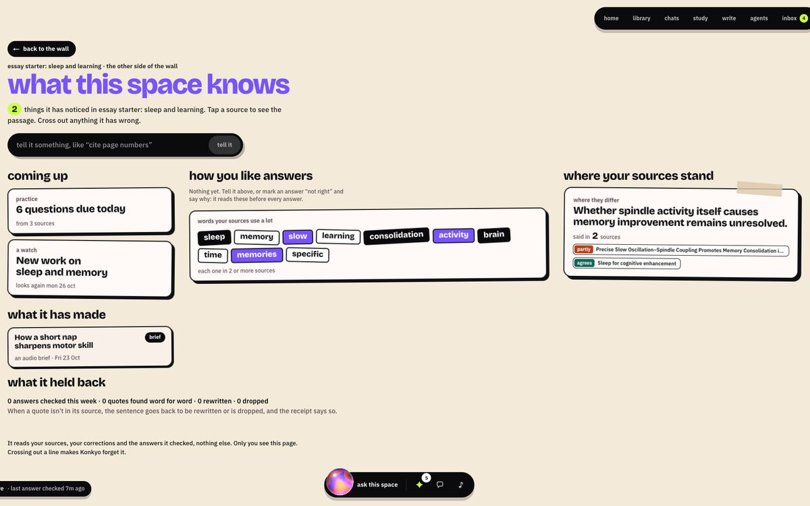</td>
  </tr>
  <tr>
    <td><b>Write.</b> Cite as you write; Check my draft marks up to 20 claims supported, partly, contradicted or not found.</td>
    <td><b>Knows.</b> Who said what across a space, kept in the World Model, each stance quoted.</td>
  </tr>
</table>

- **Bring anything in:** PDF, Word, slides, web pages, YouTube, lecture recordings cited to the
  second, and Gmail, Drive or Notion imports. Each file is read into Zetaris before it's ready.
- **Ask and compare:** across the library, a space or chosen files, by typing or out loud to the
  orb; **Compare** lines the sources up claim by claim; deep search finds open papers when your
  library runs out.
- **Listen:** two-voice audio briefs of a space, every fact cited.
- **Agents that keep working:** watch a topic for new papers and see the newest placed against
  what you have; a weekly quiz; a brief remade when a space changes. Every run reports to your Inbox.
- **Publish:** an article is checked against your sources first, and its page says how many
  claims held.
- **CLI and API:** `pnpm konkyo ask`, and `POST /api/v1/ask` with streamed steps.

Guides: [The guide](https://docs.konkyo.xyz/docs/guide) ·
[Spaces and sharing](https://docs.konkyo.xyz/docs/guide/spaces) ·
[CLI and API](https://docs.konkyo.xyz/docs/build/cli-and-api)

## Run it yourself

Needs Node 22.18+, pnpm, Docker, a Zetaris instance, OpenAI, NVIDIA and ElevenLabs API keys, and
a Google OAuth client.

```bash
cp .env.example .env       # every variable is described there
pnpm install
pnpm services:up           # Postgres + pgvector, object storage, Gotenberg
pnpm db:migrate
pnpm dev                   # web on :3210, the worker, docs on :3211
```

Docker for everything, Zetaris setup and every variable: [Self-hosting](https://docs.konkyo.xyz/docs/build/self-hosting).

```
apps/web          Next.js 16 app, API routes, /api/v1/ask
apps/worker       reading files, deep search, study sets, agents, briefs
apps/cli          pnpm konkyo: ask, samples, seed
apps/docs         the docs site
packages/agents   the agents, the tracer
packages/models   every model call: providers, fallbacks, limits
packages/zetaris  evidence store, quote checks, watch tables
packages/meterless  H-MEM, World Model, Markovian (Apache-2.0)
packages/tape     record and replay for sample mode
examples/ data/   recorded runs, sample sources
```

## Honest limits

- Live answers need Zetaris: nothing is marked verified without it.
- NVIDIA's free tier allows about 40 requests a minute per model, so the Nemotron fallback path is
  slower. If every model for a role is busy, the answer says so.
- Sample mode replays the recorded questions only; any other question is refused.
- Fair-use caps: 300 answers, 20 deep searches and 300 files a day per account (guests get less).
- Scanned pages are read with OCR, which can miss handwriting and complex tables.

## AI usage

Models while Konkyo runs: OpenAI `gpt-6-luna` and `gpt-5-nano`, NVIDIA Nemotron (3 Ultra,
3.5 Lightning, 3.5 Embed, 3.5 Content Safety, 3.5 Super VL as a reserve) and ElevenLabs speech.
The illustrations were made once with OpenAI's image models
([`make-images.mjs`](scripts/make-images.mjs)). Built with an AI coding assistant, disclosed here
as the event's AI usage policy asks.

## Licences and credits

The Meterless engines are Apache-2.0
([NOTICE](packages/meterless/NOTICE)). The sample sources are CC BY and CC BY-NC-SA
([data/](data/README.md)). Interface sounds are from [Mixkit](https://mixkit.co/license/#sfxFree);
fonts are Bricolage Grotesque and IBM Plex (SIL OFL).
